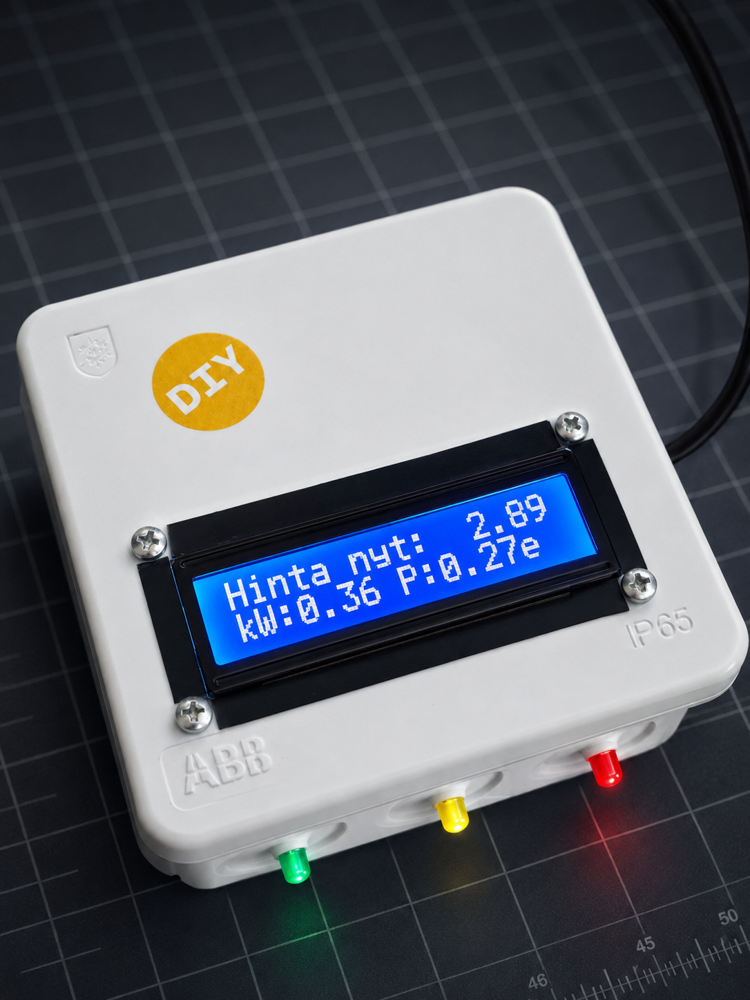

IoT electricity consumption monitor that reads pulses from an energy meter's LED indicator,
calculates real-time power consumption, correlates it with Finnish electricity spot prices
from ENTSO-E, and displays the result on an LCD.

## Display unit



The display unit is an Arduino MKR WiFi 1010 housed in a white IP65-rated enclosure.
The 16×2 LCD shows the current spot price in cents/kWh on the top row ("Hinta nyt: 2.89")
and the 10-second average power draw alongside the accumulated daily electricity cost in
euros on the bottom row ("kW:0.36 P:0.27e"). Three status LEDs on the front panel indicate
the current price tier: green (< 2 c/kWh), yellow (2–10 c/kWh), and red (≥ 10 c/kWh).

## Data pipeline

```
Energy meter LED
      ↓ light flashes (1000 pulses/kWh)
  LDR on Seeeduino XIAO (A0)
      ↓ USB serial (9600 baud)
  read_energy.py → energy_log.txt
      ↓
  ele_api.py (Flask, port 5000)
      ↓ WiFi HTTP polling (every 10s)
  ele_monitor2 (MKR WiFi 1010) → 16×2 LCD + status LEDs
```

## Components

| Directory / file | Purpose |
|---|---|
| `ele_monitor2.ino` | Display board firmware (MKR WiFi 1010) |
| `pulse_sensor/` | Pulse sensor firmware (Seeeduino XIAO) and serial logger |
| `web_app/` | Flask API combining energy data and spot prices |

See the sub-READMEs in `pulse_sensor/` and `web_app/` for setup instructions,
and `CLAUDE.md` for full architecture and build details.
